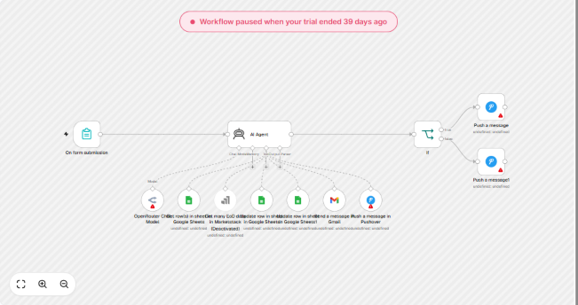
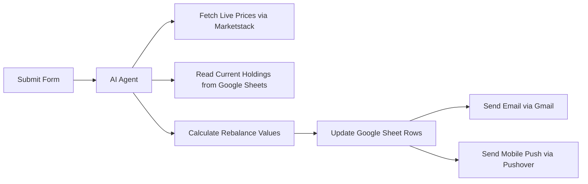

# Autonomous Equity Portfolio Rebalancer (n8n + AI)

A practical automation workflow built with n8n that helps rebalance an investment portfolio automatically. It checks real-time closing stock prices, figures out what adjustments are needed to hit target allocations, updates your spreadsheet, and sends an alert straight to your phone and inbox.

---

## The Problem It Solves

If you manage an investment portfolio, keeping asset allocation balanced takes repetitive manual work. Prices change daily, which means you normally have to:
1. Look up today's closing stock prices.
2. Calculate how far your portfolio has drifted from your targets.
3. Update your tracking spreadsheet with new values.
4. Keep track of what changed.

Doing this by hand is slow and easy to make arithmetic mistakes. I built this workflow to let an AI agent handle the data fetching, calculations, and routine updates automatically.

---

## How It Works (Step-by-Step)

### Workflow Graph in n8n



### Execution Pipeline



1. **Trigger:** You submit a simple web form to request a portfolio review.
2. **Fetch Live Prices:** The agent calls the **Marketstack API** to grab official End-of-Day (EoD) stock quotes for your holdings.
3. **Read Current Balance:** It reads your current positions and target percentages directly from **Google Sheets**.
4. **Smart Math:** An LLM-powered agent (running through **OpenRouter**) calculates how many shares you need to buy or sell to return to your target allocation.
5. **Update the Sheet:** It writes the updated values right back into the Google Sheet.
6. **Alerts:** Once finished, it emails an audit summary report to your **Gmail** and pings a notification to your phone using **Pushover**.

---

## Tech Stack

- **Workflow Engine:** [n8n](https://n8n.io/)
- **AI Agent:** OpenRouter (OpenAI / Claude models via n8n LangChain agent node)
- **Financial Data:** Marketstack API
- **Database / Ledger:** Google Sheets
- **Notifications:** Gmail & Pushover

---

## How to Set It Up

If you want to use this workflow in your own n8n instance:

### 1. Download the Workflow
Clone this repository or download the JSON file:
```bash
git clone https://github.com/MUNEEBJAVAID/autonomous-equity-portfolio-rebalancer.git
```
The workflow file is inside `workflow/P1_Equity_Rebalancer.json`.

### 2. Import into n8n
1. Open your n8n workspace.
2. Create a new workflow.
3. Click the top-right menu (`...`) and choose **Import from File**.
4. Select `P1_Equity_Rebalancer.json`.

### 3. Add Your API Credentials
You will need your own keys for the following services:
- **OpenRouter API Key** (for the AI Agent node)
- **Marketstack API Key** (for stock market quotes)
- **Google Sheets OAuth** (to read and write to your portfolio sheet)
- **Gmail OAuth** (for sending the recap email)
- **Pushover User Key & Token** (optional, only if you want mobile alerts)

### 4. Test It
Open the Form node, click "Test step", submit sample ticker symbols, and check your Google Sheet to see the numbers update automatically.

---

## What I Learned Building This

- **API Rate Limiting & Clean Data:** Connecting live financial data taught me how important it is to handle API response formats cleanly before passing them into an LLM.
- **Reliable Agent Design:** Giving the AI agent specific tools (read sheet, get prices, update sheet) rather than asking it to guess numbers makes the system reliable and prevents hallucinations.
- **Multi-node Coordination:** Coordinating 12 distinct nodes across webhooks, conditions, and messaging services created a solid, error-tolerant automation.

---

## License
MIT License. Feel free to use and modify this for your own projects!
